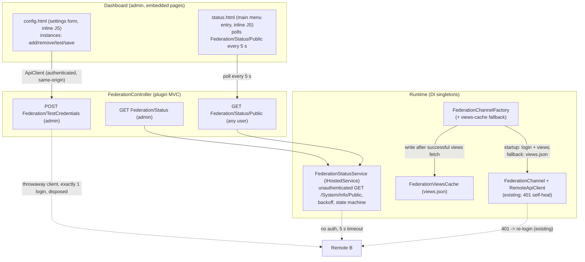

# Jellyfin Federation — UI, Status & Down-Resilience

**Date:**    2026-11-22
**Branch:**  `feat/ui-and-status`
**Status:**  Approved design (2026-11-22), not yet implemented
**Target:**  ../jellyfin master / 13.0.0-dev (7c2c5948c6); linuxserver/jellyfin 12.2.0 (container build)

## Goal

Three features for the federation plugin, all without host changes:

1. **Config via UI** — manage federation instances (alias, server URL, username,
   password) from the Jellyfin dashboard instead of hand-editing the XML.
2. **Down-safety** — a remote that is unreachable must not silently degrade:
   reachability is monitored, channels created earlier keep working and
   self-heal when the remote returns, and invalid credentials are surfaced.
3. **Status page** — per-remote live state (reachable, remote version, last
   error, channels, last authenticated contact) in the same dashboard page.

Scope decision (user, 2026-11-22): *all three phases in one spec*; restart model
*save + explicit restart button*; UI placed *only under Dashboard → Plugins*
(no main-menu entry); spec language English.

## Verified host facts (all checked against ../jellyfin)

| Fact                                                                                        | Evidence                                                                                          |
|---------------------------------------------------------------------------------------------|---------------------------------------------------------------------------------------------------|
| Plugins expose dashboard pages via `IHasWebPages`/`PluginPageInfo`; the host serves them as embedded resources        | `Jellyfin.Api/Controllers/DashboardController.cs:73-95` (`GET web/ConfigurationPage?name=…`)   |
| jellyfin-web loads plugin pages **inline** into the dashboard (not an iframe); the page JS runs with the authenticated dashboard `ApiClient` | `src/components/ServerContentPage.tsx` + `apps/dashboard/routes/routes.tsx:48-49` (`view='/web/configurationpage'`) |
| The host serves plugin config via `GET/POST /Plugins/{id}/Configuration`, persisting through `BasePlugin.SaveConfiguration` (same XML file this plugin already uses) | `Jellyfin.Api/Controllers/PluginsController.cs:164-213`; `MediaBrowser.Common/Plugins/BasePluginOfT.cs:155-176` |
| Plugin assemblies are automatically registered as MVC application parts; a plugin `ControllerBase` subclass just works  | `Emby.Server.Implementations/ApplicationHost.cs:1010` (`GetApiPluginAssemblies`); `Jellyfin.Server/Extensions/ApiServiceCollectionExtensions.cs:158-161` |
| The host's plugin-config endpoints are **admin-only**: `PluginsController` carries a class-level `[Authorize(Policy = Policies.RequiresElevation)]` covering `GET/POST /Plugins/{id}/Configuration` | `Jellyfin.Api/Controllers/PluginsController.cs:25-27`                                                          |
| The default auth policy requires authentication only — **not** admin; elevation needs an explicit policy | `Jellyfin.Server/Extensions/ApiServiceCollectionExtensions.cs:63-78`; `Jellyfin.Api/Auth/.../DefaultAuthorizationHandler.cs:47-70` |
| `POST /System/Restart` exists (`LocalAccessOrRequiresElevation`)                        | `Jellyfin.Api/Controllers/SystemController.cs:114-124`                                            |
| `ChannelManager` receives `IEnumerable<IChannel>` once in its constructor; **no** runtime add/remove API → no hot channel registration | `src/Jellyfin.LiveTv/Channels/ChannelManager.cs:81-95` (`internal IChannel[] Channels`)       |
| Plugin services registered via `IPluginServiceRegistrator` land in the same `IServiceCollection` the generic host builds → plugin `IHostedService`s run | `Emby.Server.Implementations/ApplicationHost.cs:490-492`; `Jellyfin.Server/Program.cs:178-193` |
| `MediaBrowser.Model`/`MediaBrowser.Common` carry `<FrameworkReference Include="Microsoft.AspNetCore.App" />`, which flows through **project** references only | `MediaBrowser.Common/MediaBrowser.Common.csproj:17`; **probe-verified**: a `ControllerBase` compiles in the source-checkout target but fails with CS0234 in the container target until the container csproj gains an explicit `FrameworkReference` |
| Host `GetDashboardConfigurationPage` has **no** `[Authorize]` attribute (any authenticated user can fetch plugin page HTML); page HTML must therefore contain no secrets, real data comes only through admin-gated API calls | `DashboardController.cs:73-95`                                                                   |

## Non-goals

- No hot-reload of channels: `ChannelManager` is fixed at startup (see facts).
  Config changes (including newly added remotes) always apply after a restart.
  Making this work would require a host change — out of scope by project rule.
- No automatic restart after saving (deliberate user decision).
- No self-federation, no play-state sync, no remote transcoding (unchanged V1
  limitations).
- The reachability monitor never authenticates (see invariant 11) — credential
  validity is only tested on demand.
- No localization of the plugin page (English UI strings, like the host's own
  plugin pages).

## Architecture

## Phase 1 — Config UI

Mechanism: **reuse the host's plugin-page pattern** (TMDb/MusicBrainz style).
No custom endpoint for config read/write, no auth plumbing, no token handling.

| Piece                          | Design                                                                                                                                                |
|--------------------------------|-------------------------------------------------------------------------------------------------------------------------------------------------------|
| `Plugin : IHasWebPages`        | `GetPages()` returns two `PluginPageInfo`s: **settings** — `Name = "Jellyfin Federation"`, `EmbeddedResourcePath = "Jellyfin.Plugin.Federation.Web.config.html"`, `EnableInMainMenu = false` (Dashboard → Plugins only); **status** — `Name = "Jellyfin Federation Status"`, `EmbeddedResourcePath = "Jellyfin.Plugin.Federation.Web.status.html"`, `EnableInMainMenu = true` (main menu entry). The host's menu-list endpoint (`web/ConfigurationPages`) is elevation-gated, so both surfaces are admin-only in the web client (host constraint, see README Limitations); the status page deliberately polls the reduced public endpoint, which any authenticated user can call from a custom client. |
| `src/Web/config.html`          | Self-contained settings page (inline JS, no separate `config.js` — the host's own plugins keep JS inline in the html). `data-role="page"`, `data-require="emby-input,emby-button"`, `pageshow` handler. Loads via `ApiClient.getPluginConfiguration(pluginId)`, saves via `ApiClient.updatePluginConfiguration(pluginId, config)`. Instances form only — no status panel (that moved to the status page). Vanilla JS, no framework, no external CDN (must work in offline/Tailscale setups). |
| `src/Web/status.html`          | Self-contained status page (inline JS), the main-menu entry. `data-role="page"`, `pageshow` handler polls `Federation/Status/Public` every 5 s. Renders per remote: colored state dot, alias, state, remote name/version, channel list; a failed fetch renders a visible "status unavailable" line instead of an empty table. Vanilla JS, no framework, no external CDN. |
| Settings tab                   | One form block per instance: `Alias`, `ServerUrl`, `Username`, `Password` (masked input; value round-trips through the host config API like all host plugin pages — admin-only surface). Buttons: add instance, remove instance, per-instance **Test connection**, **Save**. Client-side validation: http/https URL parses, alias/username non-empty, duplicate alias → warning. The saved XML stays byte-compatible with the hand-edited format; the file remains the single source of truth (`BasePlugin.SaveConfiguration`). |
| Test connection                | `POST Federation/TestCredentials` (our own controller, introduced with this phase). Uses a **throwaway** `RemoteApiClient` (fresh `HttpClient`, fresh DeviceId suffix), performs exactly **one** login plus views fetch, then disposes. Never touches the persistent per-instance client — a login on the persistent client would roll a new DeviceId and orphan tokens baked into persisted image URLs (invariant 2). Result JSON: `{ ok: true, libraryCount: n }` or `{ ok: false, reason: "Unreachable" \| "InvalidCredentials" \| "ServerError" }` (auth failure = 401/403 from the login attempt; unreachable = connection/timeout; server error = any other non-success login status). |
| Save → restart                 | After `updatePluginConfiguration` succeeds, the page shows "Saved — restart required to apply" and a **Restart now** button that calls `POST System/Restart` through the authenticated dashboard client. No auto-restart, no `NotifyPendingRestart` (user decision). |

## Phase 2 — Status

| Piece                                | Design                                                                                                                                                                                                                                                                                                                                                             |
|--------------------------------------|---------------------------------------------------------------------------------------------------------------------------------------------------------------------------------------------------------|
| `FederationController : ControllerBase` | Plugin MVC controller (auto-registered as application part). Class-level `[Authorize]` (authentication required on every action — never anonymous). `GET Status` and `POST TestCredentials` carry `[Authorize(Policy = Policies.RequiresElevation)]`; the host's *default* policy only requires authentication (verified), which would expose instance URLs to every logged-in user. `GET Status/Public` carries no policy (any authenticated user) and returns reduced fields only. `Policies` comes from `MediaBrowser.Common.Api` (referenced in both build targets). |
| `GET Federation/Status/Public`         | Per instance, reduced fields only: `alias`, `state`, `remoteServerName` + `remoteVersion`, `channels`. **Never** `serverUrl`, `username`, `lastError`, `lastAuthenticatedUtc`, `lastCheckedUtc` — those exist only on the admin `GET Status`. Lets a custom client (or the status page) render a non-sensitive view for any authenticated user of A. |
| `GET Federation/Status`              | Per instance: `alias`, `serverUrl`, `username` (**never** password), `state` ∈ `Unknown \| Online \| Offline \| InvalidCredentials`, `lastError` (a fixed sanitized category string — `unreachable` / `timeout` / `remote returned {code}` / `remote error` / `probe failed` — never raw exception text, so no stack, no query strings, no tokens can leak; invariant 9), `lastCheckedUtc`, `remoteVersion` + `remoteServerName` (from public info), `channels` (names of the channels this instance contributed), `lastAuthenticatedUtc` (last successful authenticated request of the persistent client, `null` if B was down at startup and it never logged in). State transitions: `InvalidCredentials` is set only by a failed login (401/403) — via the persistent client's re-login failure or the Test button; it clears back to `Online` on the next successful authenticated request or successful test. |
| `POST Federation/TestCredentials`    | See phase 1. Also admin-gated. Exactly one login attempt — a wrong password must feed the remote's lockout counter exactly once (invariant 3 extension to the UI path).                                                                                                  |
| `FederationStatusService`           | `IHostedService`, registered by `FederationPluginServiceRegistrator` (plugin registrations land in the host's service collection — verified). Own `HttpClient` (5 s timeout, **no** `Authorization` header). Per instance: `GET {serverUrl}/System/Info/Public`. Online: 30 s interval. Offline: exponential backoff 30 s → 60 s → 120 s → … capped at 10 min, per-instance offset so instances don't synchronize. |
| Status page                  | `status.html` (main menu entry, see phase 1). Polls `Federation/Status/Public` every 5 s while visible. Renders per remote: colored state dot, alias, state, remote name/version, channel list; a failed fetch renders a visible "status unavailable" line instead of an empty table. (Originally the spec put a status panel inside the settings page; it was split out to its own page because the settings page is the admin-only configuration surface, and the status belongs to the main menu entry. Deviation recorded below.)                                       |

### New invariant 11 — the monitor never authenticates

`FederationStatusService` must never call `AuthenticateByName` or send the
access token. Reasons:

- A login per check would create a device row on the remote per check (with a
  fresh DeviceId) or — with a stable DeviceId — revoke the token baked into
  persisted image URLs (invariants 2, 3).
- Unauthenticated `/System/Info/Public` answers "is B up" plus version at
  near-zero cost and zero credential risk.

Credential validity (`InvalidCredentials`) enters the status only through (a)
the Test-connection button and (b) the persistent client's 401-re-login failure
(the existing single-shot path reports auth failure to the status service).

## Phase 3 — Survival (remote down)

| Piece                       | Design                                                                                                                                                                                                                                                                                                                                                                  |
|-----------------------------|-------------------------------------------------------------------------------------------------------------------------------------------------------------------------------------------------------------------------------------------------------------------------------|
| `FederationViewsCache`      | JSON file per instance: `{DataPath}/federation/{sha256(alias + "\|" + serverUrl + "\|" + username)[..16]}/views.json` (a persistent path, not the purged image cache — so a down-at-startup rebuild survives restarts; `IApplicationPaths` has no generic `CachePath`). Content: per view — remote library id, name, collection type, and the **final channel name** including dedup suffix (used verbatim on cache read so names stay byte-stable). Username is in the key so a credential rotation does not rebuild the previous user's library set. Written **only after a successful startup login's views fetch** (the authoritative saved-credentials path — never from a Test-connection click, which may use unsaved credentials). Corrupt file → treated as absent (log warning). |
| Factory fallback            | If the startup login fails with a **transient** error (connection refused, timeout, 5xx/503 — **not** 401/403, which stay definitive per invariant 3) and a views cache exists for the instance, the factory builds the channels **from the cache**: same `FederationChannelOptions` (alias, channel name, remote library id, trimmed server URL), same `RemoteApiClient` instance, but **without a token**. |
| Self-healing                | A token-less client keeps credentials in memory. The first authenticated request triggers exactly one **proactive** login before sending — single-flight under the existing `_loginLock`, so concurrent callers share one login (a duplicate login would create an extra device row, invariant 2) — and no request is ever sent with an empty `ApiKey` (no dead 401 round-trip). The channel heals with zero new machinery when B returns. Mid-run token revocation/remote restarts keep using the existing single-shot 401 re-login path (`RefreshTokenAsync`). |
| DataVersion                 | Unchanged: `SHA256(alias \| remoteLibraryId \| serverUrl)` (invariant 10). Cache-built and live channels produce identical `DataVersion` → no cache churn, no re-hydration storm. |
| Documented expectations    | B down at A's start **with** cache: channels present in the sidebar; their content is bounded by the host's channel-item file cache (3 h), then empty until B is back. B down at A's start **without** cache (new instance, never seen): no channels — the status page shows `Offline`, plus the hint that a restart creates them once B is reachable. New/renamed libraries on B require an A restart (no runtime channel add — host constraint, see facts). |

## Error handling

- **Startup, remote down (no cache):** as today — instance skipped, `LogError`,
  server starts; additionally status row `Offline` with last error.
- **Startup, remote down (with cache):** channels from cache, `LogWarning`
  "using cached views from {date}", status `Offline`.
- **Browsing while B is down:** unchanged — the channel manager swallows
  provider exceptions as empty results; the plugin logs (`LogError`) and the
  status service records the failure — the reporting callback lives on
  `RemoteApiClient` itself (set once per instance by the factory), so every
  authenticated call path (browse, playback info, views) reports outcomes
  uniformly and `FederationChannel` stays unchanged. The status page thus
  reflects real request outcomes, not just probe results.
- **Credentials changed on B (mid-run):** request 401 → re-login → if that
  login also fails 401/403: single attempt, no retry loop (lockout), status
  becomes `InvalidCredentials`, channel errors surface to the client as today.
  The admin sees it on the status page, fixes the password via the UI, tests,
  saves, restarts.
- **Status API itself:** never throws on remote failure; unreachable remotes
  are data (`Offline` + `lastError`), not errors.

## Security review

- `GET Status` and `POST TestCredentials` are admin-only (`RequiresElevation`);
  `GET Status/Public` is auth-only (any user) and returns reduced fields. The
  embedded page HTML contains no secrets (it is fetchable by any authenticated
  user — verified host behavior — so it only renders data it pulls from the
  endpoint its visibility level allows).
- No password, token, or `ApiKey`-bearing URL ever appears in `GET Status`
  responses or in the page; `lastError` strings are sanitized (invariant 9
  extends to the status surface).
- Test-connection and the monitor are lockout-safe: one login per click, zero
  logins from the loop (invariants 3 + 11).
- New device rows on B remain bounded as today: one per plugin start plus one
  per test click; the monitor adds none (invariant 2 consequence unchanged).
- The config file continues to hold the password in plaintext (`chmod 600`);
  the UI changes nothing about that (documented limitation stays).

## Testing (xUnit, `FakeHttpMessageHandler`, fully offline)

| Test                                                                                          | Pins                                                        |
|-----------------------------------------------------------------------------------------------|--------------------------------------------------------------|
| Status service: public info 200 → `Online` + version captured; 503 → backoff sequence 30/60/120 s (fake clock); connection refused → `Offline`; **no `AuthenticateByName` request in the whole handler log** | invariant 11, backoff                                        |
| TestCredentials: 200 → `ok + libraryCount`; 401 → `InvalidCredentials` with **exactly one** login request; unreachable → `Unreachable`                                        | single-shot, no retry (invariant 3 on the UI path)          |
| Factory fallback: transient failure + cache present → channels built from cache with identical names/`DataVersion`; transient failure without cache → no channels; 401 + cache → **no** channels (definitive); successful login → cache written; alias/URL change → cache ignored                                     | phase 3, invariant 10                                        |
| Token-less client: first `GetChannelItems` on a prepared client triggers exactly one **proactive** login (empty-token path), then the request goes out with the fresh token — exactly one login request in the whole handler log; concurrent calls share one login (existing `_loginLock`)                                                   | self-healing, invariant on the refresh race                  |
| Controller: `GET Status` response contains no password/token/ApiKey substring; `RequiresElevation` on `Status`/`TestCredentials`, class-level `[Authorize]` and no `[AllowAnonymous]`; `GET Status/Public` carries no policy and its response contains no URL/username/lastError field                    | invariants 9, admin-gating + public reduction           |
| Views cache: write/read round-trip; corrupt JSON → absent; final channel name (dedup suffix) survives round-trip                                                              | cache stability                                              |
| Config round-trip: `PluginConfiguration` round-trips through the host's JSON contract (`JsonDefaults.Options`, PascalCase) — the exact property keys the page JS reads/writes are pinned, so a rename in either direction fails the test; the host's `XmlSerializer` persistence path is pinned separately by the existing `LoadConfig` tests | phase 1 |

## Files

**New** (all under `src/`, namespace `Jellyfin.Plugin.Federation`):

- `Web/config.html` — embedded settings page (self-contained, inline JS; no separate `config.js`)
- `Web/status.html` — embedded status page (self-contained, inline JS), the main-menu entry
- `FederationController.cs` — `Status` (admin), `Status/Public` (any authenticated user, reduced fields: alias/state/remote name+version/channel names — no URLs/usernames/errors), `TestCredentials` (admin) — anonymous response types; no `StatusModels.cs` (single consumer)
- `FederationStatusService.cs` — `IHostedService` reachability loop + in-memory state
- `FederationViewsCache.cs` — views cache load/save
- Tests: `FederationStatusServiceTests.cs`, `FederationControllerTests.cs`, `FederationViewsCacheTests.cs`, factory/channel additions to existing test files

**Changed**:

- `Plugin.cs` — implement `IHasWebPages`
- `RemoteApiClient.cs` — credential-without-token mode (factory fallback), `lastAuthenticatedUtc` tracking, and a reporting callback into the status service for request outcomes (success → `lastAuthenticatedUtc`, failure → `lastError`, 401/403 on re-login → `InvalidCredentials`)
- `FederationChannelFactory.cs` — cache fallback + cache write + status hooks
- `FederationPluginServiceRegistrator.cs` — register status service (hosted), controller dependencies, status singleton
- `Jellyfin.Plugin.Federation.csproj` — `<EmbeddedResource Include="Web/config.html" />` + `Web/status.html` (pinned `LogicalName` in both targets)
- `container/Jellyfin.Plugin.Federation.Container.csproj` — same `EmbeddedResource`; **`<FrameworkReference Include="Microsoft.AspNetCore.App" />`** (probe-verified: required for `ControllerBase`; the source-checkout target inherits it transitively through the `MediaBrowser.Common` project reference, the HintPath-DLL container target does not). One reference covers everything: `IHostedService` (`Microsoft.Extensions.Hosting.Abstractions`) and `AddHostedService` (`Microsoft.Extensions.DependencyInjection`) ship in the same shared framework (verified against the SDK ref pack) — no additional extracted container-refs DLLs needed.

**Docs**:

- `README.md` — configuration section becomes "via dashboard (or XML file, unchanged format)"; limitations list replaces "remote must be reachable at startup" with the survival behavior; new Status section
- `AGENTS.md` — new invariants 11 (monitor never authenticates) and 12 (views cache is the only path to channels without a live login; only transient failures qualify); allowed-reference note for the container `FrameworkReference`
- `docs/design.md` — link this spec, status "Extended (2026-11-22)"

## Implementation order

The plan deviates from this spec's phase order deliberately: the **reporter +
views-cache + status-service groundwork lands first** (plan Tasks 1–4) because
the UI and the status endpoints depend on them, and each task stays independently
green. Concretely:

1. **Phase 3 groundwork + token-less client** (plan Tasks 1–3: `RemoteApiClient`
   prepare/reporter, `FederationViewsCache`, factory fallback) — the
   self-healing client and cache the status page will display.
2. **Phase 2** (plan Tasks 4–5: status service, status + test-credentials
   endpoints) — makes phase 3 observable.
3. **Phase 1 UI** (plan Task 7: embedded page + `IHasWebPages`) — reads the
   already-existing endpoints; wiring (Task 6) and docs (Task 8) interleave.

Each task lands green: both csproj targets build, `dotnet test` passes, and the
task's tests fail without the task's change.

## Deviations from this approved spec

- **Two pages, not one:** the spec originally put a status panel on top of the
  single settings page (`config.html`). Implemented as two separate embedded
  pages instead: **settings** (`config.html`, `EnableInMainMenu = false`,
  Dashboard → Plugins only) and **status** (`status.html`,
  `EnableInMainMenu = true`, main menu entry). The status page polls
  `Federation/Status/Public` (the reduced endpoint) rather than the admin-only
  `Federation/Status`, so it stays reachable from a custom client. The settings
  page's per-instance Test button is the only credential-testing surface.
  `GetPages()` returns both `PluginPageInfo`s.
- **Anonymous response types:** the controller returns anonymous types instead
  of a `StatusModels.cs` (single consumer; the response shape is pinned by the
  controller tests).
- **Inline JS:** both pages keep their JavaScript inline in `config.html` /
  `status.html` (host plugins do the same); no separate JS files.
- **Main-menu entry + reduced public status** (user-requested after
  approval): the status page gets its own `PluginPageInfo` with
  `EnableInMainMenu = true`; the settings page keeps
  `EnableInMainMenu = false` (spec had one page, no main menu). The host's
  `web/ConfigurationPages` endpoint and the `configurationpage` SPA route
  are admin-gated (verified in host source and the deployed SPA bundle), so
  both pages remain **admin-only in the web client**; `EnableInMainMenu`
  costs nothing and helps admin discovery. The controller moved from
  class-level elevation to per-action elevation and gained
  `GET Federation/Status/Public` (`[Authorize]`, reduced fields: alias,
  state, remote name/version, channel names — no URLs/usernames/errors) so
  regular users or custom clients can display a status without the admin
  surface.

## Risks

- **Container `FrameworkReference`**: compile-time-only; the shared framework ships in every Jellyfin image (the host is an ASP.NET Core app). Probe-verified both directions (fails without, compiles with). Runtime DLL-availability risk: none — same assemblies the host already loads.
- **Plugin-page JS contract** (`ApiClient` globals, `emby-*` elements): pattern is stable across the host's own plugins (TMDb, MusicBrainz, ListenBrainz use it today), but needs a manual browser verification against the target dashboard once — part of phase 1 verification.
- **`GetDashboardConfigurationPage` is only default-policy protected** (any authenticated user): mitigated by keeping the page secret-free (no inline data).
- **`IHostedService` activation for plugins**: plugin registrations provably land in the host's service collection (verified call chain), but the first live run must confirm `StartAsync` fires (phase 2 verification step).
- **Inline-loading of plugin pages depends on jellyfin-web's view manager**: the deployed dashboard must keep `configurationpage` routing (present in current jellyfin-web master; verified). Older dashboards that iframe the page also work — the page uses no parent-frame access.
